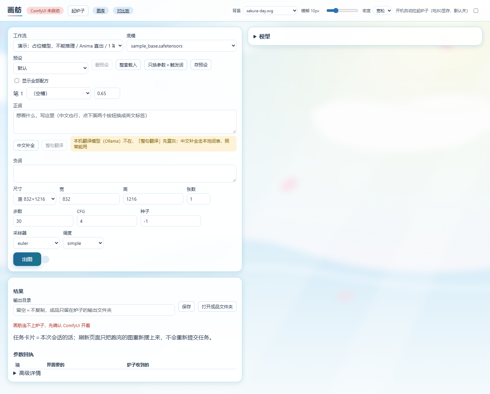
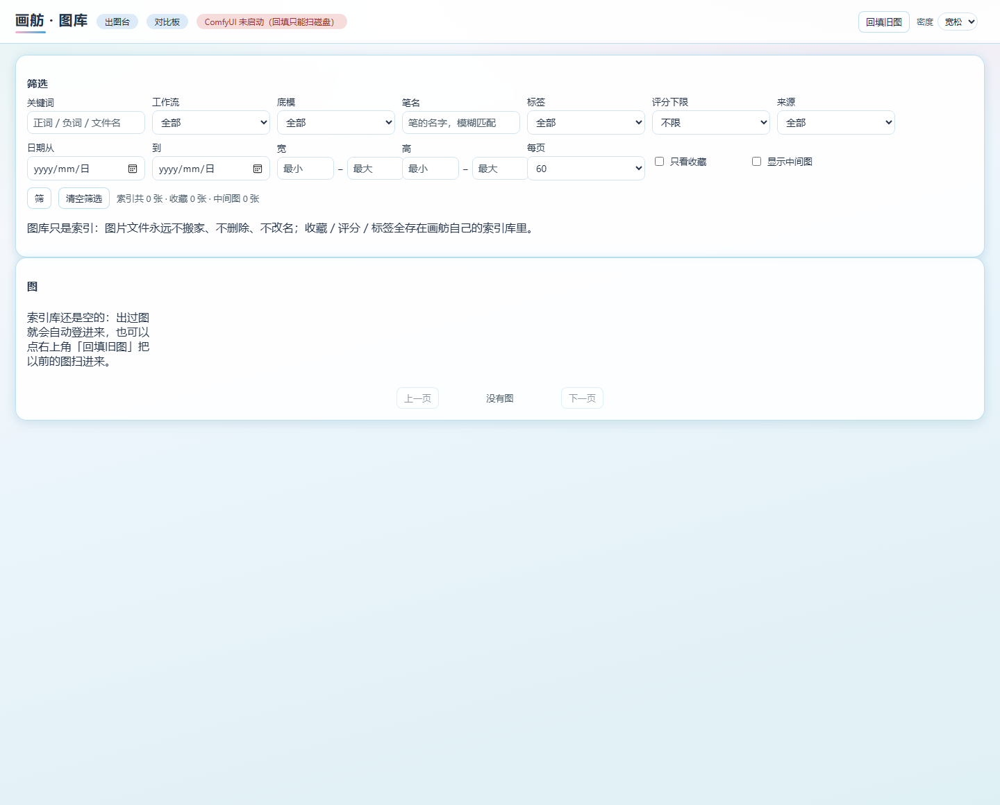

# 画舫

画舫是运行在 Windows 本机上的 ComfyUI Web 出图台：在浏览器里选工作流、填写提示词和参数，查看出图结果、参数回执与图库。

## 界面预览

以下截图均来自独立占位演示配置：模型列表只含 `sample_base.safetensors`、`sample_te.safetensors`、`sample_vae.safetensors`、`sample_style.safetensors`，它们只有测试用的空头部，不能用于推理。临时演示工作流仅将模型文件名引用换成这些样例名，仓库中的工作流保持原样。文件存在性与结构契约可以通过，并不代表真实模型加载或出图已通过。

自动拉起关闭，背景使用仓库自带的手写 SVG；画面只包含应用页面。截图如实保留“ComfyUI 未启动”等状态，没有真实出图结果。





## 安装

准备 Windows、Python 3.12，以及已经能独立运行的 ComfyUI。将项目放到一个自己选择的目录，在该目录打开 PowerShell。项目不附带 Python、ComfyUI、模型或模型下载链接。

下面两种安装方式任选一种。都直接使用虚拟环境里的解释器，不需要修改 PowerShell 执行策略。

### 使用 uv

先确保 `uv` 已安装，再执行：

```powershell
uv venv --python 3.12 .venv
uv pip install --python .\.venv\Scripts\python.exe -r requirements.txt
```

### 使用 Python venv

```powershell
py -3.12 -m venv .venv
.\.venv\Scripts\python.exe -m pip install -r requirements.txt
```

如果没有 `py` 命令，可以用自己安装的 Python 3.12 解释器完整路径替代 `py -3.12`；路径有空格时使用 PowerShell 的 `& "解释器完整路径"` 调用。

上面的安装命令默认使用官方 PyPI。

### 国内网络可选镜像

若访问官方 PyPI 较慢，可在上面的依赖安装命令后追加 `--index-url https://pypi.tuna.tsinghua.edu.cn/simple`。这是可选项，按所选安装方式使用对应命令：

使用 uv：

```powershell
uv pip install --python .\.venv\Scripts\python.exe -r requirements.txt --index-url https://pypi.tuna.tsinghua.edu.cn/simple
```

使用 Python venv：

```powershell
.\.venv\Scripts\python.exe -m pip install -r requirements.txt --index-url https://pypi.tuna.tsinghua.edu.cn/simple
```

## 配置与启动

先建立本地配置：

```powershell
New-Item -ItemType Directory -Path .\data -Force | Out-Null
Copy-Item .\settings.example.json .\data\settings.json
notepad .\data\settings.json
```

`settings.example.json` 中的目录是通用示意值，需要按实际安装位置修改：

| 字段 | 填写内容 |
| --- | --- |
| `models_dir` | ComfyUI 的 `models` 完整目录 |
| `output_dir` | ComfyUI 的 `output` 完整目录 |
| `comfy_url` | ComfyUI 的本机地址，默认 `http://127.0.0.1:8188` |
| `output.dir` | 可选的成品复制目录；留空则仅保存到 ComfyUI |
| `comfy.bat` / `comfy.vbs` | 可选的本地启动脚本；留空时手动启动 ComfyUI |
| `comfy.auto_start` | 默认关闭；打开后每次启动最多尝试自动拉起一次 |

Windows 路径在 JSON 中建议写成 `C:/AI/ComfyUI/models`；使用反斜杠时必须写成 `C:\\AI\\ComfyUI\\models`。目录要填完整路径，避免只写 `models` 这样的相对路径。修改模型根目录和输出根目录后，需要重启画舫。

若首次直接启动而没有配置，终端会提示编辑 `data/settings.json`，并指向示例文件。填好配置、准备好模型后，先手动启动 ComfyUI，再运行：

```powershell
.\.venv\Scripts\python.exe -B -m uvicorn app.main:app --host 127.0.0.1 --port 8788
```

浏览器打开 <http://127.0.0.1:8788>。保持本机地址和默认端口；应用目前只接受这组本机 Host/Origin。使用完毕后，在启动终端按 `Ctrl+C` 关闭画舫；ComfyUI 独立运行，需要另行关闭。

## 自备模型

把模型放入 ComfyUI 对应子目录。默认直出工作流需要：

| 类型 | 文件名 | 位于 `models` 下的目录 |
| --- | --- | --- |
| 底模 | `anima-base-v1.0.safetensors` | `diffusion_models/` |
| 文本编码器（TE） | `qwen_3_06b_base.safetensors` | `text_encoders/` |
| VAE | `qwen_image_vae.safetensors` | `vae/` |
| 笔（LoRA）占位名 | `sample_style.safetensors` | `loras/` |

其他工作流分别使用 `anima-aesthetic-v1.1.safetensors`、`anima-turbo-v1.1.safetensors` 或 `chosenIrisesMix_v20Anima.safetensors`。只需准备所选工作流需要的模型，并确认 ComfyUI 已支持工作流使用的节点。

`sample_style.safetensors` 只是公开样例名称，仓库没有附带这个文件。请自行提供兼容 LoRA，或将所用工作流各笔槽的默认文件名换成自己的文件名。当前契约会核对默认笔文件是否存在，即使该槽强度为 0；缺少文件时界面会说明原因并阻止出图。多笔样例可以在不同槽使用同一个样例名称，槽位与强度仍各自独立。

触发词表与中文补全词表也需要自备。`trigger_map`、`zh.table` 留空时，分别尝试读取 `data/trigger_map.json`、`data/zh_tags.json`；缺表有容错。整句翻译需要另行配置本机 Ollama，可在 `zh.enabled` 中关闭中文辅助。

## 仅浏览界面的演示配置

没有模型也可以启动页面。下面的配置将模型与输出指向临时空目录，关闭中文辅助和自动拉起。它会覆盖本项目的本地设置；已有设置请先自行备份。

```powershell
$demoRoot = Join-Path $env:TEMP ("huafang-demo-" + [guid]::NewGuid().ToString("N"))
New-Item -ItemType Directory -Path (Join-Path $demoRoot "models"),(Join-Path $demoRoot "output"),.\data -Force | Out-Null
$cfg = Get-Content .\settings.example.json -Raw -Encoding UTF8 | ConvertFrom-Json
$cfg.models_dir = Join-Path $demoRoot "models"
$cfg.output_dir = Join-Path $demoRoot "output"
$cfg.comfy.bat = ""
$cfg.comfy.vbs = ""
$cfg.comfy.auto_start = $false
$cfg.zh.enabled = $false
$json = $cfg | ConvertTo-Json -Depth 8
[System.IO.File]::WriteAllText((Join-Path (Get-Location) "data/settings.json"), $json, [System.Text.UTF8Encoding]::new($false))
.\.venv\Scripts\python.exe -B -m uvicorn app.main:app --host 127.0.0.1 --port 8788
```

打开页面时会显示缺少模型、ComfyUI 尚未连接等提示，这是空目录演示的预期状态。上面的截图使用另一份占位演示档；其临时模型文件只含假头部，不能用于推理。空目录演示与占位演示都没有产生真实出图结果。

## 背景图

可将自己有使用权限的图片放入 `static/bg/`，刷新后从顶栏“背景”下拉选择；也可使用页面的背景上传入口。支持 PNG、JPEG、WebP、GIF、SVG、AVIF。顶栏可以调整模糊程度、关闭背景或切换界面密度。仓库自带 `sakura-day.svg` 和 `moonlit-night.svg` 两份手写几何示例，README 截图使用前者。

## 测试

```powershell
$env:PYTHONDONTWRITEBYTECODE = "1"
.\.venv\Scripts\python.exe -B -m unittest discover -s tests -t .
```

单测使用临时配置和不能用于推理的假模型头部，不启动真实 ComfyUI。两项真实模型检查默认跳过；需要时设置 `HUAFANG_TEST_MODELS_DIR` 指向自己的模型根目录再执行。单测通过不表示真实模型出图已经验收。

## 许可

项目使用 [MIT License](LICENSE)，版权署名为 `weiyilu350-cyber`。自备模型、第三方节点及自行添加的背景素材分别遵守其原有许可。
